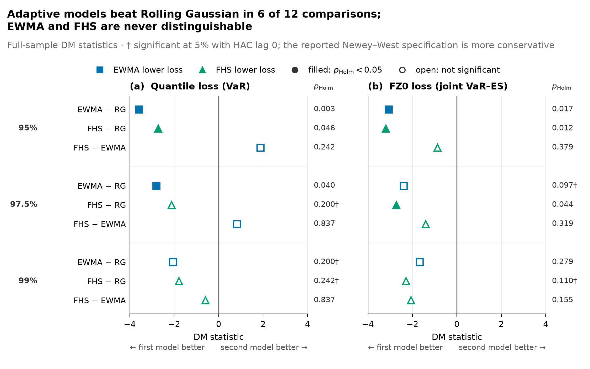
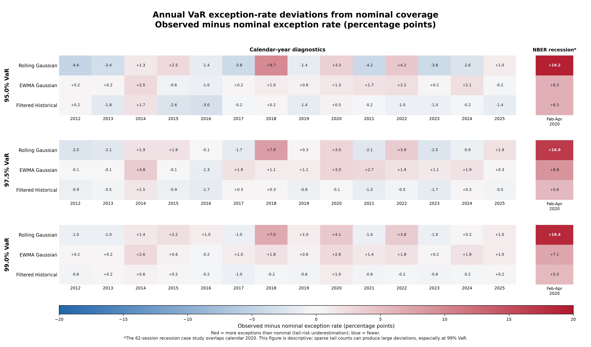
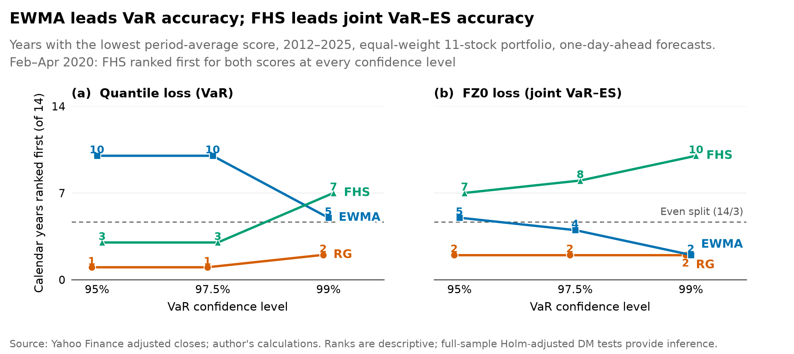

# Portfolio Tail-Risk Engine

[](https://github.com/Upkar-2004/Portfolio-Tail-Risk-Engine/actions/workflows/tests.yml)

A reproducible research engine for comparing one-day portfolio Value at Risk
(VaR) and Expected Shortfall (ES) forecasts across changing market regimes.

- **Current baseline:** `v0.1.0` Python research baseline
- **Baseline status:** complete, tested, and documented
- **Validation:** 650 automated tests

## Research question

Do models that respond to changing volatility and non-Gaussian returns produce
better one-day portfolio tail-risk forecasts than a conventional rolling
Gaussian model?

The baseline study compares three methods on the same 11-asset portfolio,
forecast dates, realized losses, confidence levels, and scoring rules:

| Model | Role in the comparison |
| --- | --- |
| Rolling Gaussian | Fixed-window Gaussian benchmark |
| EWMA Gaussian | Tests whether faster covariance adaptation improves forecasts |
| Filtered Historical Simulation | Adds filtered empirical innovations and non-Gaussian tails |

The experiment covers 3,519 one-day-ahead forecasts from 2012 through 2025.
Each model produces 95%, 97.5%, and 99% VaR and ES estimates from 100,000
scenarios per forecast date.

## Results at a glance

- After Holm adjustment, EWMA or FHS significantly outperformed Rolling
  Gaussian in 6 of the 12 adaptive-model-versus-benchmark comparisons across
  the two score families and three confidence levels.
- EWMA and FHS were not statistically distinguishable from one another in any
  full-sample comparison. Their relative advantage depends on whether VaR is
  scored alone or VaR and ES are scored jointly.
- Calibration varied materially through time. All three models underestimated
  99% tail risk during the February-April 2020 contraction, with the Rolling
  Gaussian model showing the largest exception-rate miss.
- Lag-zero HAC inference would produce five additional rejections. The primary
  automatic-bandwidth Newey-West specification is therefore retained as the
  more conservative result.

These claims distinguish descriptive subperiod patterns from the project's
primary full-sample, multiplicity-adjusted inference. See
[`docs/results.md`](docs/results.md) for the complete interpretation and
limitations.

## Featured result

[](reports/figures/predictive_accuracy_dm_comparison.svg)

The figure reports full-sample pairwise predictive-accuracy statistics for VaR
quantile loss and joint VaR-ES FZ0 loss. Negative values favor the first named
model. Filled markers denote Holm-adjusted rejection within the relevant
nine-test score family; daggers identify conclusions that are sensitive to
using HAC lag zero instead of the primary automatic bandwidth.

## Figure gallery

### Calibration through time

[](reports/figures/subperiod_exception_rate_heatmap.svg)

Observed VaR exception rates vary substantially across years and during the
separately defined 2020 stress period. Color represents the observed rate minus
the nominal exception rate; it is a descriptive diagnostic rather than a
pass-or-fail test.

### Which model ranked first?

[](reports/figures/subperiod_predictive_first_place_summary.svg)

EWMA leads most often for VaR quantile loss at 95% and 97.5%, while FHS becomes
more competitive at 99% and when VaR and ES are evaluated jointly. The annual
counts describe the pattern; the full-sample figure above carries the formal
inference.

Additional publication figures and their companion tables are catalogued in
[`reports/`](reports/README.md).

## Statistical and engineering scope

The current baseline includes:

- fixed-window rolling Gaussian, EWMA Gaussian, and filtered historical
  simulation forecasts;
- a common no-look-ahead forecast schedule and beginning-of-session portfolio
  weights;
- Kupiec unconditional coverage and Christoffersen independence and
  conditional-coverage tests;
- exact Clopper-Pearson exception-rate intervals and descriptive tail-severity
  diagnostics;
- joint VaR-ES calibration diagnostics;
- quantile loss, FZ0 loss, and pairwise predictive-accuracy comparisons;
- Newey-West HAC uncertainty and predeclared Holm multiple-testing families;
- Basel-style rolling 250-session traffic-light diagnostics;
- checksum-verified, non-overwriting data and result snapshots; and
- deterministic publication figures generated from verified result tables.

The engine uses the positive-loss convention: portfolio loss is the negative
of portfolio return, and ES is at least as large as VaR.

## Research pipeline

```text
Market data
    -> validated raw snapshot
    -> asset-return snapshot
    -> portfolio path and realized losses
    -> aligned rolling forecasts from each model
    -> calibration, severity, and predictive-accuracy evaluation
    -> immutable result snapshots
    -> tracked publication figures and compact tables
```

Every generated snapshot records its configuration, source lineage, and
SHA-256 checksums. Large raw data and forecast artifacts remain local, while
selected figures and small tables are committed under `reports/`.

## Repository structure

```text
configs/             Versioned experiment definitions
python/tailrisk/     Research engine and statistical implementation
python/tailrisk/figures/
                     Figure-family modules using one shared house style
scripts/             Reproducible data, backtest, evaluation, and report commands
tests/python/        Unit, integration, boundary, and artifact tests
docs/                Methodology, decisions, results, roadmap, and reproduction
reports/             Curated publication figures and compact result tables
data/                Local generated snapshots; policies are tracked, data are not
cpp/                 Documented future numerical-acceleration phase
```

## Quick start

Python 3.12 or newer is required.

```bash
python3 -m venv .venv
.venv/bin/python -m pip install --upgrade pip
.venv/bin/python -m pip install -e ".[dev]"
.venv/bin/pytest -q
```

The full baseline is intentionally more substantial than a quick demo: it
downloads market data and runs three 3,519-date, 100,000-scenario backtests.
The complete staged workflow, smoke-test command, official snapshot lineage,
and every reporting command are documented in
[`docs/reproduction.md`](docs/reproduction.md).

## Extension contract

The repository is designed so the completed baseline remains reproducible as
the research program grows. A new model or empirical extension should add:

1. a configuration or predeclared protocol;
2. an implementation behind the existing data and forecast contracts;
3. controlled tests and cross-model alignment checks;
4. a methodology and decision-log update;
5. a versioned, checksum-verified result snapshot; and
6. generated publication artifacts with an explicit inferential status.

Reusable engine changes return to `main`. Paper-specific configurations,
tables, and manuscripts can live under future `papers/` subdirectories and
reference a tagged engine release instead of maintaining divergent copies of
the core code.

## Release and extension path

`v0.1.0` is the completed Python baseline and is suitable for portfolio and
resume presentation. Planned extensions build on it rather than redefine it:

- additional conditional-volatility and tail-distribution models;
- robustness across portfolio constructions and stress definitions;
- formal regime-comparison extensions;
- a validated C++ numerical simulation core with thin Python bindings; and
- paper-specific experiments based on frozen configurations and release tags.

The current Python findings do not depend on those future phases.

## Documentation

- [`docs/methodology.md`](docs/methodology.md): mathematical definitions,
  timing conventions, and statistical procedures
- [`docs/results.md`](docs/results.md): detailed findings, captions, and
  limitations
- [`docs/reproduction.md`](docs/reproduction.md): installation and complete
  command reference
- [`docs/decisions.md`](docs/decisions.md): append-only research and engineering
  decisions
- [`docs/project-checkpoints.md`](docs/project-checkpoints.md): verified
  milestones, snapshot identifiers, and checksums
- [`docs/roadmap.md`](docs/roadmap.md): release-based extension plan
- [`docs/portfolio-case-study.md`](docs/portfolio-case-study.md): concise copy
  for a resume and portfolio website
- [`docs/data-sources.md`](docs/data-sources.md): data provenance and use policy
- [`docs/project-charter.md`](docs/project-charter.md): long-term research and
  engineering scope

## Limitations

This is a research system, not a production trading, pricing, or regulatory
capital platform. The baseline uses daily data, a linear long-only portfolio,
one-day horizons, three model families, and a fixed historical universe.
Subperiod figures are descriptive unless the documentation explicitly states
otherwise. Market-data availability and revisions can also prevent a later
download from being byte-identical to the preserved baseline snapshot.

## License

Copyright (c) 2026 Upkar Singh. All rights reserved. No license is currently
granted for reuse, modification, or redistribution. See [`LICENSE`](LICENSE)
for the complete notice.
